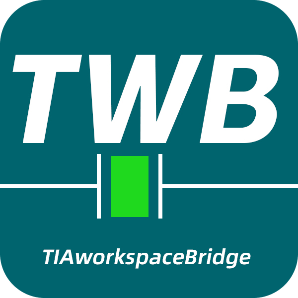
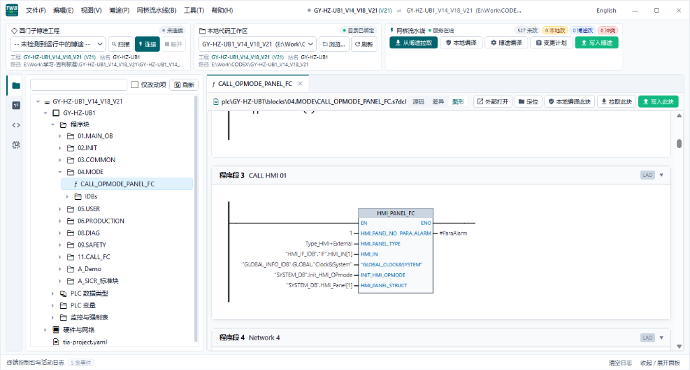

<div align="center">
  
  <h1>TIA Workspace Bridge (TWB)</h1>
  <p><strong>辅助 CODEX、Claude、Workbuddy、Copilot 等现代 AI 探索西门子博途 PLC 工程的实验性开发辅助套件</strong></p>
  <p>
    导出博途工程本身是博途原生（VCI / Openness）已有的基础能力，TWB 并非重新发明轮子，而是在原生能力之上尝试打通 <strong>AI 辅助电气工程师编程的落地流程</strong>：<br/>
    通过自动注入 <code>AGENTS.md</code> 规范约束尝试降低 AI 语法幻觉、提供 Agent 专用的 <code>twb</code> CLI 交互入口、过滤动态时间戳噪点、提供本地快速初筛校验以及基于指纹并发防覆盖（OCC）的回写防护。
  </p>

  <p>
    <a href="https://opensource.org/licenses/MIT"></a>
    <a href="https://www.microsoft.com"></a>
    <a href="https://support.industry.siemens.com"></a>
    <a href="https://dotnet.microsoft.com"></a>
  </p>

  <p>
    <a href="https://gitee.com/coobi7/TIAworkspaceBridge/releases/latest"><strong>📥 Gitee 极速下载 (国内发行版)</strong></a> &nbsp;•&nbsp;
    <a href="https://github.com/coobi7/TIAworkspaceBridge/releases/latest"><strong>🌐 GitHub Releases (海外发行版)</strong></a>
  </p>

  <p>
    
  </p>
</div>

> **开发状态说明**：本项目目前处于早期探索与持续迭代阶段，**必然存在尚未完善的功能、特定版本边界限制以及潜在 BUG**。我们不作任何效果或商业使用保证，欢迎工控与软件同行多提 Issue 和宝贵建议，共同探讨工控 AI 落地。  
> **适用环境**：TIA Portal V18 / V19 / V20 / V21 · 西门子 S7-1200 / S7-1500 PLC · Windows 10/11 x64  
> *(注：受博途各版本底层 Openness 差异限制，V18 下 LAD/FBD/GRAPH 仅支持导出解析与差异审查，回写仅限 SCL/DB/UDT；硬件声明式比对与装配回写目前为实验性功能，仅在博途 V21 架构上支持)*  
> **推荐配合**：CODEX、Workbuddy、Claude Code、VS Code、GitHub Copilot、Windsurf、Antigravity 等现代 AI 工具

---

## 目录

- [1. 为什么不仅是“导出工程”？](#1-为什么不仅是导出工程)
- [2. 核心架构原理](#2-核心架构原理)
- [3. 环境准备与快速上手](#3-环境准备与快速上手)
- [4. TWB 桌面统一驾驶舱 (GUI Cockpit)](#4-twb-桌面统一驾驶舱-gui-cockpit)
- [5. 5 分钟快速上手 (CLI 模式)](#5-5-分钟快速上手-cli-模式)
- [6. CLI 命令速查手册](#6-cli-命令速查手册)
- [7. 工作区目录与编码规约](#7-工作区目录与编码规约)
- [8. AI Coding Agent 接入指南](#8-ai-coding-agent-接入指南)
- [9. 常见问题排查 (FAQ)](#9-常见问题排查-faq)
- [10. 免责声明与社区反馈](#10-免责声明与社区反馈)

---

## 1. 为什么不仅是“导出工程”？

导出博途程序块本身是博途自带（如 VCI 接口、外部源导出）已具备的成熟能力，TWB 并不是重新发明导出功能。但在实际尝试让通用 AI 辅助开发西门子程序时，工控工程师往往会遭遇不少实际摩擦：
- **AI 容易写出无法编译的语法**：西门子外部源语法要求严格，UTF-8 BOM、花括号元数据、伴随资源等细节繁杂，通用 AI 并不天生理解；
- **原生导出文件充满 Diff 噪点**：动态编译时间戳和 XML 结构变化常导致 Git 每次拉取都产生大量假改动；
- **AI 缺乏命令行交互通道**：AI Agent 无法独立探查工程连通状态，往往需要工程师在博途和聊天窗口之间反复复制粘贴；
- **直接回写现场存在风险**：直接让 AI 产出代码写回博途容易覆盖现场在线修改，缺乏并发保护机制。

### TWB 尝试解决与探索的实用能力
1. **自动生成与注入 `AGENTS.md` 规约文档**：
   从博途拉取工程时，TWB 自动生成针对当前工程的 `AGENTS.md` 上下文。AI Agent 读取后能了解工程站名、UTF-8 BOM 标头、SCL 编写规范与订货号要求，尽量减少离谱的语法幻觉。
2. **专为 AI Coding Agent 封装的 `twb` CLI 工具链**：
   提供独立的命令行接口，AI Agent 可按需自主调用：
   - `twb status`：探测博途连接、当前工程与站名；
   - `twb validate <file>`：本地快速轻量语法与结构初筛，提前拦截低级格式失误；
   - `twb query refs <Symbol>` / `twb query io <Address>`：反查全局引用与物理 IO 槽位；
   - `twb plan` & `twb apply`：生成变更集并执行带指纹校验的安全回写。
3. **噪点过滤与 LAD 梯形图图形对比**：
   内置规范化过滤器，尽量滤除博途动态时间戳噪点；GUI 客户端提供基于 SVG 的 LAD 梯形图图形预览与局部差异高亮，辅助阅读程序结构。
4. **无需频繁启动博途编译的本地快速初筛**：
   博途增量编译耗时较长，TWB 提供本地轻量校验器（检查 BOM 标头、括号平衡、块首尾完整性与 DB 成员引用等），先做第一道快速初筛，减少无效编译等待。
5. **OCC 乐观并发防覆盖检查 (Safe Apply)**：
   每次回写前比对在线工程并发指纹。如果现场 PLC 工程在拉取后已被他人改动，系统会拦截静默覆盖，降低误写现场的风险。
6. **离线物理 IO 与变量表交叉检索**：
   无需频繁唤醒博途，快速定位物理地址（如 `%I10.0`）对应的模块槽位、绑定变量或悬空通道，辅助 AI 重构逻辑时理清硬件依赖。
7. **硬件声明式扫描与实验性 IaC**：
   支持将硬件组态扫描并导出为声明式 YAML 与 IO 映射表；在博途 V21 架构下支持实验性的硬件声明式比对与装配回写。

---

## 2. 核心架构原理

```text
┌─────────────────────────────────────────────────────────────────────────────┐
│            AI Coding Agent / Developer (CODEX / Workbuddy / IDE)            │
│                       Local Filesystem & Git Workspace                      │
└──────────────────────┬───────────────────────────────┬──────────────────────┘
                       │ 命令行控制                     │ 可视化交互
                       ▼                               ▼
┌─────────────────────────────────────┐ ┌─────────────────────────────────────┐
│               twb CLI               │ │       twb-app Desktop Cockpit       │
│ status | pull | query | validate... │ │ 5大Tab + Diff审查 + 内嵌控制台终端  │
└──────────────────────┬──────────────┘ └──────────────┬──────────────────────┘
                       │                               │
                       └───────────────┬───────────────┘
                                       │ NamedPipe IPC (双向超时与锁保护)
                                       ▼
┌─────────────────────────────────────────────────────────────────────────────┐
│                            twb-service Daemon                               │
│  ┌───────────────────────┐  ┌───────────────────────┐  ┌──────────────────┐ │
│  │     ModelIndexer      │  │  CanonicalNormalizer  │  │ HardwareApplier  │ │
│  │ 符号/交叉引用/IO反查  │  │   规范化差异处理器    │  │ 硬件IaC (V21实验)│ │
│  └───────────────────────┘  └───────────────────────┘  └──────────────────┘ │
│  ┌───────────────────────┐  ┌───────────────────────┐                       │
│  │    StateRepository    │  │   SandboxValidator    │                       │
│  │ SQLite 指纹与状态库   │  │ Level 1/2 本地校验器  │                       │
│  └───────────────────────┘  └───────────────────────┘                       │
└──────────────────────────────────────┬──────────────────────────────────────┘
                                       │ C# Openness API (Siemens.Engineering)
                                       ▼
┌─────────────────────────────────────────────────────────────────────────────┐
│                   Siemens TIA Portal (V18 / V19 / V20 / V21)                │
└─────────────────────────────────────────────────────────────────────────────┘
```

---

## 3. 环境准备与快速上手

### 前置要求
1. **操作系统**：Windows 10 / 11 64-bit。
2. **西门子博途**：TIA Portal V18 / V19 / V20 / V21，且已安装 Siemens Openness 组件。
3. **用户组授权**：当前 Windows 用户必须加入 **`Siemens TIA Openness`** 用户组（计算机管理 -> 本地用户和组 -> 组）。配置后需**注销 Windows 当前会话重新登录**方可生效。
4. **运行环境**：.NET Framework 4.8（Windows 10/11 系统通常已预装）。

### 下载与安装运行（开箱即用免编译）
TWB 发布为绿色便携版与单文件程序，无需配置编译环境即可开箱体验：

1. 前往 **[Gitee Releases (国内镜像)](https://gitee.com/coobi7/TIAworkspaceBridge/releases/latest)** 或 **[GitHub Releases](https://github.com/coobi7/TIAworkspaceBridge/releases/latest)** 下载最新发行包：
   - **单文件便携版 (`TIAworkspaceBridge.exe`)**：整合了 GUI、CLI 与后台守护服务的单个可执行程序，双击直接运行桌面驾驶舱；
   - **绿色便携包 (`.zip`)**：解压即可获得完整的客户端与独立命令行程序。
2. **使用 CLI 命令行**：将包含 `twb.exe`（或 `TIAworkspaceBridge.exe`）的目录添加到系统的 `PATH` 环境变量中，即可在任意终端窗口直接使用 `twb` 指令。

---

## 4. TWB 桌面统一驾驶舱 (GUI Cockpit)

> **设计初衷**：为电气与自动化工程师提供一个直观的操作面板，免去手动开黑框启动后台服务的繁琐流程，集成工程结构浏览、差异比对与轻量诊断。采用现代工业浅色风格，原生支持中英文（zh-CN / en-US）一键热切换。

双击启动 `TIAworkspaceBridge.exe`（或 `twb-app.exe`）即可进入工作区：

<div align="center">
  
</div>

### 核心面板概览

#### 1. 服务自动托管与连接状态
- 客户端启动时**自动探测并静默拉起后台服务**（`twb-service.exe`），无需手动开启守护进程；
- 顶部状态栏直观展示服务连通性、当前博途在线 PID 实例选择、当前工程与站名，支持一键热重连。

#### 2. Tab 1: 🌲 项目树与源码/差异审查 (Project Explorer & Diff)
- **同步博途树状结构**：拉取工程后，工作区以与博途一致的层级树呈现（`PLC 站` -> `程序块 (Program blocks)` / 子分组文件夹 -> `PLC 数据类型 (UDT)` -> `PLC 变量 (Tags)` -> `硬件 (Hardware)`）；
- **对象类型与改动指示**：标注对象类型胶囊（`OB`/`FB`/`FC`/`DB`/`UDT`/`TAG`/`HW`），发生改动的项显示状态标签（`Mod`/`Conf`）；
- **双模式审查**：
  - **源码内容 (Source Code)**：直接查看选中块的 S7DCL / SCL / UDT 源码；
  - **差异比对 (Unified Diff)**：选中改动项即可审查行级 Diff；
- **效率工具**：支持“仅改动项”过滤、关键字搜索以及“在资源管理器中定位”。

#### 3. Tab 2: 🩺 校验与编译器诊断 (Diagnostics & Compile)
- **分级诊断呈现**：汇总本地基础静态检查、结构校验以及博途真实增量编译诊断告警；
- **错误行列定位**：表格化罗列严重级别、对象名、错误代码、行列号与定位建议。

#### 4. Tab 3: 🧠 代码智能与物理 IO 检索 (Code Intelligence & IO)
- **全局符号交叉引用（XRef）**：快速查询指定 DB/FB/FC/UDT 的全局调用方与被调用方；
- **物理 IO 逆向映射**：输入物理地址（如 `%I10.0`），查询对应模块槽位、通道与绑定的 PLC 变量；
- **悬空通道审计（Dangling IO）**：扫描全工程已组态但未分配变量的物理通道，便于排查现场遗漏。

#### 5. Tab 4: 🛠 硬件组态与原生选型 (Hardware IaC & Catalog)
- **原生硬件库选型搜索**：穿透查询博途原生硬件目录，输入关键字（如 `ET 200SP`、`1515-2`）检索真实合法的订货号（MLFB）与固件版本；
- **硬件拓扑与状态机**：查看本地声明式硬件 YAML 组态结构；在博途 V21 环境下可测试声明式硬件装配。

#### 6. 底部抽屉：内嵌终端控制台与实时事件流 (Embedded CLI)
- **实时活动日志流**：显示后台服务与博途交互的事件日志（INFO/WARN/ERROR）；
- **内嵌 CLI 交互**：底部提供 `twb >` 命令行，可直接输入并执行任意 `twb` 指令，无需切换到外部黑框终端。

---

## 5. 5 分钟快速上手 (CLI 模式)

如果您更倾向于在独立终端、脚本或配合 AI Coding Agent 使用：

### 步骤 1: 确保后台服务运行
若运行单文件 `TIAworkspaceBridge.exe` 或已打开桌面客户端，后台服务已自动就绪；在纯命令行独立运行时可启动：
```powershell
twb-service.exe
```

### 步骤 2: 打开博途工程并检查连通性
打开博途并加载目标工程，运行：
```powershell
twb status
```

### 步骤 3: 投影拉取至本地工作区
```powershell
twb pull
```
拉取完成后，本地将生成与博途同构的源码文件结构，并自动更新针对该工程的 `AGENTS.md` 规约。

### 步骤 4: 本地编辑或使用 AI 助手重构
可直接使用标准 SCL 语法编辑 `plc/<Station>/blocks/` 下的逻辑，或修改 `plc/<Station>/tags/*.yaml` 变量表。

### 步骤 5: 校验与回写博途
```powershell
# 1. 本地快速静态初筛
twb validate

# 2. 生成变更计划（查看改动清单与 OCC 指纹）
twb plan

# 3. 事务性应用回写到博途工程
twb apply --yes
```

---

## 6. CLI 命令速查手册

### 工程状态与服务
```powershell
# 检查工程连通性、三方同步状态（CLEAN/CHANGED/CONFLICT）
twb status

# 重新连接正在运行的博途实例（支持指定 PID）
twb reconnect
twb reconnect --pid 17316

# 查看当前运行中的博途进程清单
twb processes

# 停止后台守护进程
twb daemon stop
```

### 快速代码智能查询 (基于本地模型，响应迅速)
```powershell
# 查询符号或块的全局调用链与交叉引用
twb query refs "DB_CylinderData"

# 查询物理硬件地址的槽位绑定与对应 PLC Tag
twb query io "%I10.0"

# 审计全工程未绑定变量的悬空物理 IO 通道
twb query dangling-io

# 本地渲染程序块图形化视图（支持追加 --open 在默认浏览器中打开）
twb view plc/PLC_1/blocks/Main.s7dcl --open
```

### 校验与真实编译
```powershell
# 本地只读轻量校验（支持指定文件或全部改动）
twb validate
twb validate plc/PLC_1/blocks/FB_CylinderControl.s7dcl

# 深度代码质量与可靠性审计 (拦截未赋初值临时变量、绝对IO、看门狗死锁与安全信号误写；--fix 自动修复)
twb lint
twb lint plc/PLC_1/blocks/FB_CylinderControl.s7dcl --fix

# 触发博途真实增量热编译（调用博途编译器，输出真实错误行列号）
twb compile
```

### 事务性应用 (Safe Apply)
```powershell
# 生成应用变更计划（执行 OCC 乐观并发安全比对）
twb plan

# 安全回写并触发编译复核
twb apply --yes

# 声明式硬件比对与装配回写 (实验性，仅博途 V21 架构支持)
twb hardware plan
twb hardware apply
```

### 硬件目录反查 (辅助核验订货号)
```powershell
# 检索博途本机安装硬件库中的合法 MLFB 订货号与版本
twb catalog search "ET 200SP"
twb catalog search "6ES7 131-6BF"
```

---

## 7. 工作区目录与编码规约

### 目录结构
```text
MyProject/
├─ tia-project.yaml            # TWB 工程绑定元数据
├─ AGENTS.md                   # AI 编程助手行为准则（供 Agent 快速接入）
├─ plc/<StationName>/          # PLC 站源码
│  ├─ blocks/                  # 程序块源码 (OB, FB, FC, DB 的 .s7dcl, .s7res)，与博途工程树同构
│  ├─ datatypes/               # 用户自定义数据类型 UDT (.s7dcl, .s7res)
│  └─ tags/                    # 声明式 PLC 变量表 (*.yaml)
├─ hardware/                   # 硬件组态声明 (*.yaml, profinet.yaml, io-map.csv)
├─ model/                      # 本地衍生只读代码模型 (symbols.json, callgraph.json)
└─ .twb/                       # TWB 内部运行时状态库 (包含 state.db 与 baseline，严禁手改)
```

### 编写语法建议与编码红线
1. **强制 UTF-8 with BOM**：所有 `.s7dcl`、`.s7res`、`.scl` 源码必须带 **UTF-8 BOM 标头**（`0xEF, 0xBB, 0xBF`），否则博途导入中文字符易产生乱码或解析报错。
2. **工作区源码格式与兼容模式（首选原生 S7DCL）**：
   - **原生 SIMATIC SD 模式（首选标准格式）**：工作区 `plc/` 下逻辑块、数据块与 UDT 的正式存储格式均为原生 `.s7dcl` 并配齐同名 `.s7res` 资源文件。采用带花括号头部属性的 S7DCL 格式（`{ S7_BlockNumber := "10"; S7_Optimized := "TRUE"; ... }`），SCL 代码逻辑包裹在 `{ S7_Language := "SCL" } NETWORK ... END_NETWORK` 内。
   - **纯净外部源 SCL 兼容支持**：TWB 亦兼容西门子官方外部源标准纯 SCL（`FUNCTION_BLOCK "Name" ... BEGIN ... END_FUNCTION_BLOCK`），回写时由内置转换器自动封装元数据并托管伴随资源；但在日常开发中首选原生 `.s7dcl` + `.s7res` 规范。
3. **数据类型与变量声明**：
   - **UDT**：使用 `TYPE UDT_Name : STRUCT ... END_STRUCT; END_TYPE`。
   - **DB**：声明式 `DATA_BLOCK "Name" VAR ... END_VAR END_DATA_BLOCK`。
   - **LAD**：如需直接编辑梯形图文本，采用 S7DCL 格式（`RUNG wire#powerrail ... END_RUNG`），严禁手写底层 XML。

---

## 8. AI Coding Agent 接入指南

若要让 CODEX、Workbuddy、Claude、Antigravity 或其他 AI Agent 协同参与博途开发：

1. **规约加载**：
   将工作区根目录下由 TWB 自动生成的 [`AGENTS.md`](./AGENTS.md) 添加到 AI 助手的系统提示词或上下文配置中。
2. **推荐的操作闭环**：
   - **第一步（感知状态）**：Agent 运行 `twb status` 与 `twb query refs` 了解工程上下文与依赖；
   - **第二步（本地编辑）**：直接在 `plc/` 下编写或修改逻辑（推荐纯 SCL 模式，并确保 UTF-8 BOM）；
   - **第三步（本地初筛）**：Agent 运行 `twb validate`，检查括号与基础结构；
   - **第四步（审查计划）**：Agent 运行 `twb plan` 向工程师展示改动清单与 OCC 指纹；
   - **第五步（落地回写）**：经工程师确认后执行 `twb apply --yes`，完成博途写入并更新基线。

---

## 9. 常见问题排查 (FAQ)

#### Q1: 运行 `twb status` 提示 `Siemens TIA Openness group unauthorized`？
- **解决**：打开 Windows“计算机管理” -> “本地用户和组” -> “组”，找到 `Siemens TIA Openness`，将当前登录用户加入该组。配置后需要**注销 Windows 当前会话重新登录**方可生效。

#### Q2: 提示 `Could not connect to TWB Daemon`？
- **解决**：TWB 采用 Client-Daemon 架构以保障响应与稳定性。若使用桌面客户端，程序会自动启动并托管后台服务；若在独立终端中使用 `twb` CLI，请确保在后台运行了 `twb-service.exe`。

#### Q3: 增量写入时提示 `OCC Conflict (Optimistic Concurrency Control)`？
- **解决**：说明自上次 `twb pull` 以来，在线博途工程中的该对象被直接修改过，或者其他进程修改了同一目标。为避免静默覆盖，TWB 会自动拦截。此时可先运行 `twb pull` 刷新基线并审查差异后再行应用。

#### Q4: 中文注释导入博途后乱码或报错？
- **解决**：请检查源文件是否保存为 **UTF-8 with BOM**（字节序标记 `EF BB BF`）。博途 Openness 对无 BOM 的 UTF-8 中文字符解析存在限制。

#### Q5: 博途 V18 下修改了梯形图 (LAD) 无法回写？
- **解决**：受西门子博途 V18 底层机制限制，外部源导入仅支持 SCL、DB 和 UDT，不支持梯形图与顺控器回写。在 V18 下建议将复杂逻辑以 SCL 块形式编写与回写。

---

## 10. 免责声明与社区反馈

- **关于软件状态与使用风险**：工业现场控制系统（PLC）关乎人身与设备安全，环境复杂严谨。TWB 目前定位为**实验性辅助开发工具**，软件难免存在未被发现的缺陷、版本不兼容或边界处理不当之处。**作者与贡献者不对使用本工具产生的任何编译失败、逻辑非预期、停机损失或数据丢失承担责任**。
- **安全使用建议**：在向任何实际运行或正式交付的博途工程执行 `twb apply` 回写前，**请务必做好博途工程的完整归档备份（TIA Archive）**，并在受控测试环境中充分验证回写后的程序逻辑与硬件组态。
- **欢迎共建与交流**：如果您在日常使用中发现了 BUG，或者有好的思路、需求或优化建议，欢迎在 [Gitee Issues](https://gitee.com/coobi7/TIAworkspaceBridge/issues) 或 [GitHub Issues](https://github.com/coobi7/TIAworkspaceBridge/issues) 中提交反馈。非常期待与各位电气、工控同行共同探讨自动化与 AI 的结合！

---

## 许可证

本项目采用 [MIT 许可证](./LICENSE) 开源发布。
